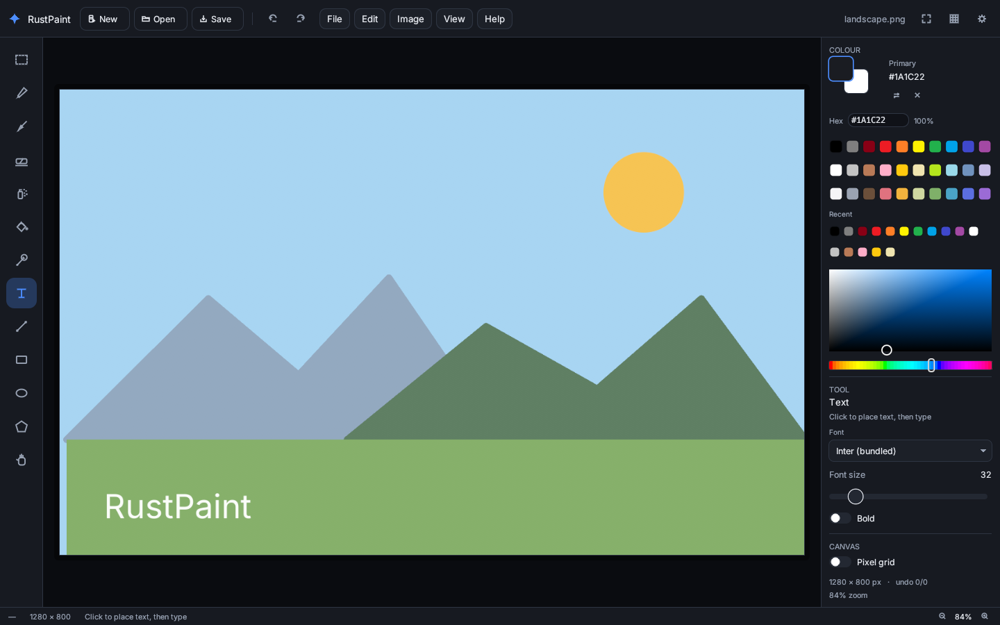
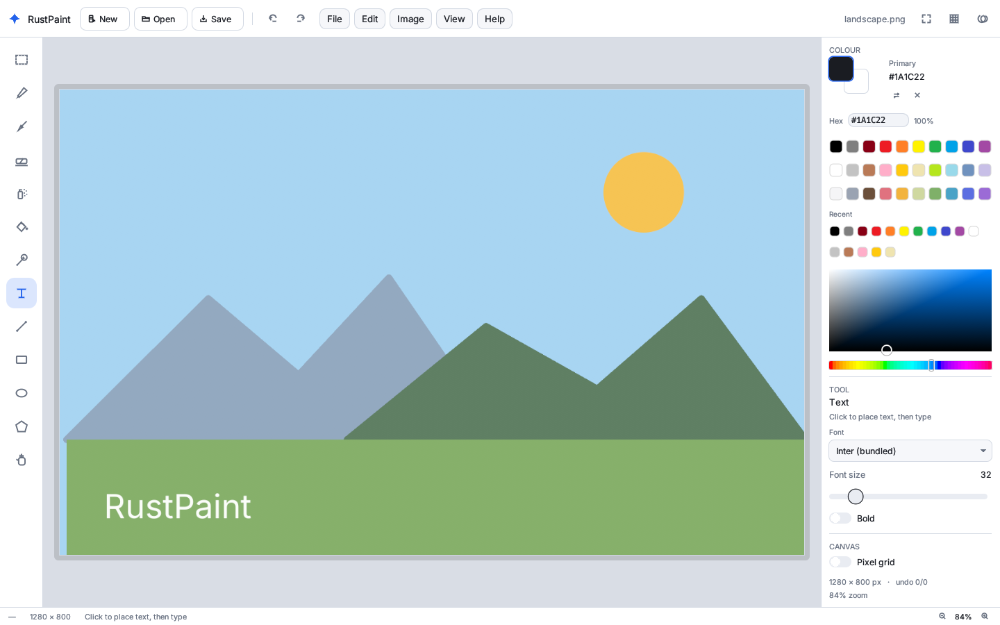

# RustPaint

A modern, Microsoft-Paint-style image editor written in Rust. One codebase builds a
native desktop app for **Windows**, **macOS** and **Linux**. A high-performant tiny executable results in a responsive interface and instantaneous startup. 





*(Both screenshots are the real app running; `examples/landscape.png` was drawn entirely
inside RustPaint with the fill, ellipse, polygon, rectangle and text tools.)*

---

## Highlights

- **Paint 11-flavoured UI** — icon tool rail, ribbon-free command bar with real menus,
  floating cards and dialogs, rounded corners, light **and** dark themes.
- **13 tools** — Select, Pencil, Brush, Eraser, Airbrush, Fill, Colour picker, Text,
  Line, Rectangle, Ellipse, Polygon, Pan.
- **Text with real fonts** — every font installed on the machine is listed in a
  searchable picker (plus two bundled faces that always work), with size, true bold
  weight and live preview on the canvas.
- **Drag & drop** — drop an image file anywhere on the window to open it (the usual
  unsaved-changes prompt still applies).
- **Remembers where you left off** — theme, canvas font, last folder and an
  "Open recent" list (8 files) are stored in a small settings file and restored on
  the next launch.
- **Real selection workflow** — marquee select, move (floating block), cut / copy / paste,
  delete, select all, crop, nudge with the arrow keys. Like Paint, an active selection
  confines painting and bucket fills to itself; starting a stroke outside it drops the
  selection instead of trapping you.
- **Numeric control** — size, opacity, hardness, anti-alias toggle, shape "filled" toggle,
  fill tolerance, font size + bold, hex input and a compact HSV picker.
- **Pixel-accurate canvas** — nearest-neighbour zoom above 1:1 (crisp pixels, optional
  pixel grid), smooth zoom below 1:1, zoom to cursor, pan with space/middle-drag/hand tool,
  "fit to window", actual size.
- **Undo / redo** — bounding-box diff based, 80 steps / 192 MB cap.
- **Files** — PNG / JPEG / BMP open & save, "unsaved changes" guard, canvas resize,
  flip / rotate / invert / grayscale.
- **Native file panels, with a safety net** — Open/Save use the real system dialogs
  (`IFileDialog` on Windows, `NSOpenPanel`/`NSSavePanel` on macOS, the XDG desktop portal
  on Linux). If no native dialog can be shown — a headless box, a WM without a portal —
  the app falls back to its own themed file browser instead of doing nothing. The two can
  be swapped any time from *File → Use system file dialogs*.
- **Responsive chrome** — the tool rail and top bar adapt down to a 940×640 window.
- **Per-tool brush sizes** — Pencil, Brush, Eraser, Airbrush and each shape keep their own
  thickness, so switching tools doesn't make you re-set the slider.
- **Big canvases stay smooth** — a stroke only re-uploads the rectangle it touched to the
  GPU instead of the whole image (a 4000×3000 canvas is 48 MB per frame otherwise), and
  anything over 40 megapixels is refused with a clear message instead of eating memory.

## Build & run

Requires a Rust toolchain (1.92+, current stable works fine) — <https://rustup.rs>. No other system SDKs beyond the
platform's usual graphics stack are needed.

```bash
git clone <this repo> rustpaint && cd rustpaint
cargo run --release
```

Release builds use fat LLVM LTO, one codegen unit, symbol stripping, and abort-on-panic. The
repository Cargo config also enables `target-cpu=native`; on Linux it asks GNU `ld` for its
highest output optimization level. This maximizes performance on the build machine, but the
resulting binary may use CPU instructions unavailable on another machine. To build a portable
release, override those machine-specific Rust flags for that invocation.

The first build compiles the dependency tree (eframe/egui, image, ab_glyph) and performs a full
link-time optimization pass, so it can take several minutes; later builds are faster.

### Windows

```powershell
cargo build --release
.\target\release\rustpaint.exe
```

Release builds use the `windows_subsystem = "windows"` attribute, so no console window
appears. Everything is statically linked except the system DLLs that ship with Windows —
the `.exe` can be copied to another Windows machine as-is (add the VC++ runtime if you
built with the `msvc` toolchain and the target lacks it).

### macOS

```bash
cargo build --release
./target/release/rustpaint          # or: cargo install --path .
```

The binary is a universal-capable native app; for a double-clickable bundle add an
`Info.plist` wrapper (or run `cargo bundle`). On Apple Silicon build with
`--target aarch64-apple-darwin`, on Intel with `--target x86_64-apple-darwin`, or use
`--target universal-apple-darwin` for a fat binary.

### Linux

```bash
sudo apt install build-essential pkg-config libxkbcommon-dev libgl1-mesa-dev \
                 libx11-dev libxcursor-dev libxrandr-dev libxi-dev
cargo run --release
```

Wayland and X11 are both supported; the OpenGL (glow) backend also works on
software rendering, remote desktops and VMs.

## Keyboard shortcuts

Tool selection is plain letters, commands use `Ctrl` on Windows/Linux and `⌘` on macOS.

| Command | Shortcut | | Tool | Shortcut |
| --- | --- | --- | --- | --- |
| New image | `Ctrl N` | | Select | `V` |
| Open image | `Ctrl O` | | Pencil | `P` |
| Save | `Ctrl S` | | Brush | `B` |
| Save as | `Ctrl ⇧ S` | | Eraser | `E` |
| Canvas size | `Ctrl E` | | Airbrush | `A` |
| Undo / Redo | `Ctrl Z` / `Ctrl ⇧ Z` or `Ctrl Y` | | Fill | `G` |
| Cut / Copy / Paste | `Ctrl X` / `Ctrl C` / `Ctrl V` | | Colour picker | `I` |
| Select all / Deselect | `Ctrl A` / `Ctrl D` | | Text | `T` |
| Delete selection | `Del` | | Line | `L` |
| Zoom in / out | `Ctrl +` / `Ctrl -` | | Rectangle | `R` |
| Actual size / Fit | `Ctrl 0` / `Ctrl 9` | | Ellipse | `O` |
| Brush size − / + | `[` / `]` | | Polygon | `K` |
| Swap colours | `X` | | Pan | `H` |
| Reset colours | `D` | | Finish polygon | `Enter` |
| Pan canvas | hold `Space` + drag, or middle-drag | | Nudge selection | arrow keys |

`F1` (or *Help → Keyboard shortcuts*) shows the same list in-app.

### Files & settings

`Ctrl+O` / `Ctrl+S` open the system panels; the built-in browser is used when those are not
available (see *File → Use system file dialogs*). Files you open or save show up under
*File → Open recent*. Where things are remembered:

| Platform | Settings file |
| --- | --- |
| Windows | `%APPDATA%\RustPaint\settings.ini` |
| macOS | `~/Library/Application Support/RustPaint/settings.ini` |
| Linux | `~/.config/rustpaint/settings.ini` |

### Text tool

Click once on the canvas, type, then press `Ctrl+Enter` (or *Apply*). The **Font**
dropdown lists every family the system reports, filtered by the search box at the top of
the popup — type `serif`, `mono`, `noto`… to narrow it down. *Bold* uses the family's real
bold face when it has one and synthesises a heavier stroke when it doesn't. Both bundled
faces (`Inter (bundled)`, `DejaVu Sans (bundled)`) are always available, so text works even
on a machine with no fonts installed.

## How it works

```
src/
  main.rs      window setup (eframe/NativeOptions), release Windows subsystem flag
  app.rs       shell: top bar, menus, dialogs, shortcuts, status bar, overlays
  paint.rs     the engine: tools, strokes, selections, zoom/pan, texture upload
  doc.rs       RGBA document buffer, region copy/blit, resize, flip/rotate, file I/O
  mask.rs      anti-aliased 8-bit coverage masks (one per stroke) + compositing
  history.rs   undo stack keyed on changed bounding boxes
  tools.rs     tool enum, tool options, colour helpers, palette
  text.rs      canvas text layout + rasterisation via ab_glyph (TTF and CFF/OTF)
  filedlg.rs   themed open/save browser (fallback when no native panel is available)
  prefs.rs     tiny settings file: theme, last folder, canvas font, recent files
  native.rs    system Open/Save panels via rfd, with availability detection
  fonts.rs     system font discovery (fontdb) + face loading for the text tool
  widgets.rs   custom widgets: buttons, swatches, toggles, sliders, HSV picker
  theme.rs     light/dark palettes + egui style
  icons.rs     every icon, drawn as vectors at runtime (no image assets)
  assets.rs    embedded fonts (Inter + DejaVu fallback)
```

Design notes worth knowing:

- **Everything rasterises into a coverage mask.** A stroke keeps a padded local snapshot of the
  canvas region it touches and paints into a sparse `u8` coverage buffer; the visible pixels are always
  `snapshot ⊕ mask`. That is what makes live previews, opacity, hardness and non-destructive
  erasing (it writes alpha 0) cheap and consistent across all tools.
- **Undo is a bounding-box diff**, so a 4000×4000 image full of history stays small:
  only the changed rectangle is stored, and the stack is capped in bytes as well as steps.
- **The canvas is a texture.** Zoom uses nearest-neighbour sampling at ≥ 1:1 for crisp
  pixels and linear below that; the pixel grid is a painter overlay, not part of the image.
- **Two file-dialog backends.** `rfd` gives the genuine platform panel; the themed browser
  stays in the binary as a fallback, so a failure in the platform integration degrades to
  "slightly different looking dialog" rather than "Open does nothing". A panel that comes
  back in under 300 ms with no file is treated as missing rather than cancelled.
- **Fonts are shared work.** `fontdb` enumerates installed families (registry / font
  directories), `ab_glyph` rasterises them — including CFF/OTF outlines. Faces are loaded lazily and cached once per
  family/weight.
- **Colours are unmanaged sRGB `u8`** in an RGBA buffer, so the same code path feeds the
  GPU texture, the PNG encoder and the fill routine.
- **The canvas texture is updated by dirty rectangle.** Every edit reports what it touched
  (`TexDirty::Rect`) and only that slice is re-uploaded; open / resize / undo / rotate mark
  the whole texture instead. Zoom changes re-upload once because the sampling mode
  (nearest vs linear) is a texture-wide setting.
- **Settings are a 6-line text file** (`theme=`, `last_dir=`, `font=`, `recent=`), written
  on change and on exit — no dependency, and deleting it resets the app.

## Notes & limitations

- Single layer, like Paint. No layer panel, no blend modes.
- Text is rasterised when you click *Apply*; it is not re-editable afterwards.
- Only upright (non-italic) faces of a family are used.
- On Linux the native panel needs `xdg-desktop-portal` running; otherwise the built-in
  browser is used automatically.
- The system clipboard is used as a marker only — copied pixels live inside the app
  (egui 0.29 does not expose image clipboard payloads cross-platform). Copy/paste inside
  RustPaint, and across windows of the app, works normally.
- JPEG has no alpha: transparent areas are flattened onto white when saving as JPEG.

## License

GPLv3
